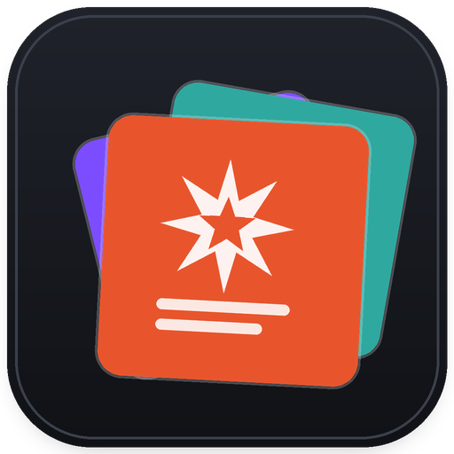

<p align="center">
  
</p>

<h1 align="center">Digital Library</h1>

<p align="center">
  مدیر کتابخانه‌ی کمیک و کتاب دیجیتال برای ویندوز، لینوکس و مک<br>
  A comic &amp; digital book library manager for Windows, Linux and macOS
</p>

<p align="center">
  <a href="https://github.com/AmirGFno/digital_library/actions/workflows/tests.yml"></a>
  <a href="https://github.com/AmirGFno/digital_library/actions/workflows/build-windows.yml"></a>
  
  
</p>

---

## فارسی

### درباره

**Digital Library** یک برنامه‌ی دسکتاپ برای مدیریت کمیک‌ها و کتاب‌های دیجیتال است.
فایل‌ها را دسته‌بندی می‌کند، کاور می‌سازد، اطلاعات کمیک را از فایل می‌خواند و هر
کتاب را با یکی از خواننده‌های کمیک نصب‌شده روی سیستم باز می‌کند.

### ویژگی‌ها

- پشتیبانی از **CBZ، CBR، CB7، CBT، ZIP، RAR، 7z، TAR، PDF و تصویر**
- خواندن خودکار **ComicInfo.xml** (سری، جلد، نویسنده، ناشر، سال، خلاصه، تعداد صفحه)
- ساخت خودکار سری از روی اطلاعات کمیک و شمارش خوانده‌نشده‌ها
- استخراج کاور از اولین صفحه‌ی PDF یا اولین تصویر آرشیو، همراه با کش
- کاور سفارشی برای هر کتاب
- برچسب **علاقه‌مندی**، امتیاز پنج‌ستاره و تاریخچه‌ی مطالعه
- جستجو در عنوان، سری، نویسنده و ناشر
- فیلتر خوانده/نخوانده/در حال مطالعه و فیلتر نوع فایل
- مرتب‌سازی بر اساس سری، عنوان، تازگی افزودن، آخرین مطالعه، امتیاز و حجم
- کشیدن و رها کردن فایل یا پوشه روی پنجره‌ی برنامه برای افزودن سریع
- ویرایش اطلاعات هر کتاب از پنجره‌ی جزئیات
- تشخیص خودکار خواننده‌های کمیک و امکان افزودن هر برنامه‌ی دلخواه
- انتخاب خواننده‌ی پیش‌فرض، یا خواننده‌ی جداگانه برای هر نوع فایل؛ ذخیره‌ی
  تنظیمات خواننده با بررسی صحت فایل ذخیره‌شده
- **پوشه‌ی پیش‌فرض کتابخانه**: فقط بار اول پرسیده می‌شود و هر کمیک تازه‌ای که
  در آن گذاشته شود، به‌صورت خودکار وارد کتابخانه می‌شود
- **افزودن پوشه‌ای**: هر زیرپوشه می‌تواند یک سری شود؛ پیش از افزودن، پرسیده
  می‌شود «سری با همین نام ساخته شود؟» و نام‌ها قابل ویرایش‌اند
- **جلوگیری از تکرار**: فایل تکراری (حتی با نام یا مسیر جدید) دوباره اضافه
  نمی‌شود و افزودن دوباره‌ی یک پوشه فقط فایل‌های تازه را وارد می‌کند
- **شماره‌ی جلد هوشمند**: عدد ۱ تا ۳ رقمی نام فایل شماره‌ی جلد می‌شود، تکراری
  هرگز ساخته نمی‌شود و در صورت نبود الگو، ترتیب تاریخی فایل‌ها ملاک است
- **انتخاب چندگانه** با `Ctrl`/`Shift` و کشیدن کادر، همراه با منوی کلیک راست
  گروهی (باز کردن، خوانده/نخوانده، علاقه‌مندی، تغییر سری و حذف)
- **پاک‌سازی نام**: حذف آیدی کانال تلگرام، نشانی سایت و عبارت‌های تبلیغاتی از
  نام کمیک، با پیش‌نمایش قبل از ذخیره
- **پرسش درباره‌ی پوشه‌های تازه**: هر پوشه‌ای که داخل پوشه‌ی کتابخانه ظاهر شود،
  یک‌بار پرسیده می‌شود که «به‌عنوان سری اضافه شود؟» و پاسخش ذخیره می‌شود
- **بازگردانی سری حذف‌شده**: حذف سری کتاب‌ها را پاک نمی‌کند و هر سری حذف‌شده را
  می‌توان از «Deleted series» یا `Ctrl+Shift+Z` دقیقاً به حالت قبل برگرداند
- **هم‌گام‌سازی با دیسک**: فایلی که از روی دیسک پاک شود، خودکار از کتابخانه هم
  حذف می‌شود (هیچ فایلی روی دیسک پاک نمی‌شود)
- **کاور CBR**: کاور فایل‌های RAR/CBR با WinRAR، 7-Zip، `unar` یا `bsdtar`
  خوانده می‌شود و وضعیت این ابزار در تنظیمات خواننده نمایش داده می‌شود
- **دیزاین تازه**: نوار بالای صفحه با آمار زنده، کارت‌های کتاب با کاور گرد و
  منوی شناور، نوار انتخاب زیر شبکه، پیام‌های Toast و کتابخانه‌ی ویجت اختصاصی
- رابط تیره‌ی مدرن، ذخیره‌ی چیدمان پنجره و پشتیبانی از DPI بالا
- نسخه‌ی **EXE تک‌فایل** بدون نیاز به نصب پایتون و با حجم بسیار کمتر (موتور PDF
  سبک جایگزین شد)

### چه چیزی در نسخه‌ی ۲.۳.۱ درست شد

- **انتخاب چندگانه**: نوار انتخاب دیگر روی کارت‌ها نمی‌افتد و دکمه‌های میان‌بر کارت
  با تأخیر کوتاه ظاهر می‌شوند، پس کلیک ساده، `Ctrl` و `Shift` همیشه کار می‌کنند
- **فایل جابه‌جاشده**: رکورد کتاب با اثر انگشت محتوا به مسیر تازه وصل می‌شود و
  وضعیت خوانده‌شدن، امتیاز و کاور حفظ می‌شوند؛ فایل حذف‌شده هم از کتابخانه برداشته
  می‌شود (هیچ فایلی روی دیسک پاک نمی‌شود)
- **سری خالی**: سری‌ای که پوشه و همه‌ی کتاب‌هایش رفته باشد از فهرست کنار می‌رود و
  در «Deleted series» برای بازگردانی می‌ماند
- **آیکون برنامه**: آیکون در پنجره، نوار وظیفه و فایل EXE نمایش داده می‌شود
- **پرسش پوشه‌ها**: پوشه‌ای که یک‌بار پاسخ گرفته دیگر دوباره پرسیده نمی‌شود
- `Ctrl+A` و `Delete` هنگام تایپ در کادر جستجو دیگر روی شبکه اثر نمی‌گذارند

### خواننده‌های پشتیبانی‌شده

| برنامه | ویندوز | لینوکس | مک |
|---|:---:|:---:|:---:|
| CDisplayEx | ✅ | — | — |
| YACReader | ✅ | ✅ | ✅ |
| ComicRack | ✅ | — | — |
| MComix | ✅ | ✅ | — |
| SumatraPDF | ✅ | — | — |
| Honeyview | ✅ | — | — |
| Comic Seer | ✅ | — | — |
| Calibre Viewer | ✅ | ✅ | ✅ |
| qComicBook / Okular / Gwenview | — | ✅ | — |
| Preview / Simple Comic | — | — | ✅ |

هر برنامه‌ی دیگری را هم می‌توانید از مسیر
**File → Reader settings → Add custom reader** اضافه کنید.

### نصب و اجرا از سورس

```bash
git clone https://github.com/AmirGFno/digital_library.git
cd digital_library
python -m pip install -r requirements.txt
python main.py
```

در ویندوز می‌توانید `run.bat` را اجرا کنید.

### دریافت نسخه‌ی EXE

از بخش [Releases](https://github.com/AmirGFno/digital_library/releases) فایل
`DigitalLibrary-2.3.1-windows-x64.zip` را دانلود کنید، از حالت فشرده خارج کنید
و `DigitalLibrary.exe` را اجرا کنید. پایتون لازم نیست.

> ویندوز ممکن است بار اول هشدار SmartScreen نشان دهد، چون فایل امضای دیجیتال
> ندارد. با «More info → Run anyway» ادامه دهید.

برنامه **قابل حمل (portable)** است: پوشه‌های `data`، `logs`، `thumbnails` و
`custom_covers` کنار فایل EXE ساخته می‌شوند. برای انتقال کتابخانه کافی است
پوشه‌ی برنامه را جابه‌جا کنید. اگر برنامه در مسیری بدون دسترسی نوشتن (مثلاً
`Program Files`) اجرا شود، به‌طور خودکار از پوشه‌ی داده‌ی کاربر استفاده می‌کند.

### نکته درباره‌ی CBR / RAR

برای خواندن فایل‌های RAR، کتابخانه‌ی `rarfile` به یکی از ابزارهای
`UnRAR`، `unar`، `bsdtar` یا `7z` نیاز دارد. اگر WinRAR یا 7-Zip نصب باشد
معمولاً به‌طور خودکار پیدا می‌شود؛ در غیر این صورت فایل را به CBZ تبدیل کنید
یا ابزار را نصب کنید. فایل‌های CBZ و ZIP بدون هیچ ابزار اضافه‌ای کار می‌کنند.

### ساخت EXE

```bat
build_windows.bat
```

یا به‌صورت دستی:

```bat
pip install -r requirements-dev.txt
pyinstaller --noconfirm --clean DigitalLibrary.spec
```

خروجی: `dist\DigitalLibrary.exe`

در گیت‌هاب، ورک‌فلوی **Build Windows executable** به‌صورت دستی یا با ساختن
تگ `v*` اجرا می‌شود و فایل EXE را به‌عنوان Artifact/Release منتشر می‌کند.

### آزمون‌ها

```bash
python -m pytest -q
```

آزمون رابط گرافیکی (بدون نمایشگر):

```bash
python scripts/smoke.py
```

### میان‌برهای صفحه‌کلید

| کلید | کار |
|---|---|
| `Ctrl+O` | افزودن کتاب |
| `Ctrl+Shift+O` | افزودن یک پوشه |
| `Ctrl+F` | جستجو |
| `Ctrl+D` | نمایش علاقه‌مندی‌ها |
| `Ctrl+,` | تنظیمات خواننده |
| `Ctrl+I` | آمار کتابخانه |
| `Ctrl+R` | هم‌گام‌سازی پوشه‌ی کتابخانه |
| `Ctrl+Shift+Z` | بازگردانی سری حذف‌شده |
| `Ctrl++` / `Ctrl+-` | کم و زیاد کردن ستون‌ها |
| `F5` | تازه‌سازی |
| دوبار کلیک | باز کردن کتاب |
| `Ctrl+A` | انتخاب همه |
| `Ctrl` + کلیک | افزودن/حذف از انتخاب |
| `Shift` + کلیک | انتخاب بازه |
| کلیک راست | منوی «Open with» یا منوی گروهی برای چند کتاب |

---

## English

### Features

- CBZ, CBR, CB7, CBT, ZIP, RAR, 7z, TAR, PDF and image support
- Automatic **ComicInfo.xml** import (series, volume, writer, publisher, year,
  summary, page count)
- Auto-created series, unread counters and reading history
- Cover extraction with cache and custom covers
- Favorites, five-star ratings, read/started filters
- Full-text search over title, series, writer and publisher
- Six sort orders, drag &amp; drop import, metadata editor and statistics
- Detects popular comic readers (including CDisplayEx) and can launch any custom
  executable, globally or per file type; reader choices are verified on disk
- Default library folder asked once, then watched: new comics are imported
  automatically
- Folder import with a per-folder "create a series with this name?" choice
- Duplicate-proof importing (path and content hash) so a second folder import
  only adds the new files
- Unique volume numbers from 1-3 digit file numbers, falling back to file dates
- Multi-selection with Ctrl/Shift/rubber band and a group right-click menu
- Cleans channel IDs, site links and advertising text out of comic names, with a
  preview before saving
- Asks once per new folder inside the library whether it should become a series
- Deleted series are restorable; deleting one never loses its books
- Files removed from the disk leave the library automatically (nothing on disk is
  ever deleted by the cleanup)
- CBR covers read through WinRAR, 7-Zip, `unar` or `bsdtar`, with the detected
  tool shown in the reader settings
- Redesigned interface: live statistics hero, rounded cover cards with a hover
  action bar, floating selection bar, toasts and a shared widget library
- Modern dark UI, saved layout, high-DPI friendly
- Single-file Windows executable (no Python required) with a much smaller size

### Quick start

```bash
git clone https://github.com/AmirGFno/digital_library.git
cd digital_library
python -m pip install -r requirements.txt
python main.py
```

### Project layout

```text
digital_library/
├── main.py                     # application entry point
├── config.py                   # paths, version, supported formats
├── database.py                 # SQLite schema, migrations and queries
├── cover_extractor.py          # PDF/archive cover extraction + cache
├── comic_metadata.py           # ComicInfo.xml / PDF metadata + page count
├── importer.py                 # import pipeline used by dialogs and drag & drop
├── volume_planner.py           # unique volume numbers from names or dates
├── pdf_engine.py               # lightweight PDF backend (pypdfium2)
├── ui/
│   ├── main_window.py          # library window
│   ├── book_card.py            # book card + context menu ("Open with")
│   ├── series_panel.py         # sidebar
│   ├── dialogs.py              # add/edit/import/cover dialogs
│   ├── details_dialog.py       # metadata viewer/editor
│   ├── reader_settings_dialog.py
│   ├── folder_import_dialog.py # folder preview, series names and volumes
│   ├── name_preview_dialog.py  # cleaned titles shown before saving
│   ├── library_grid.py         # grid with rubber-band selection
│   ├── welcome_dialog.py       # first-run library folder
│   ├── new_folder_dialog.py    # "should this folder become a series?"
│   ├── restore_dialog.py       # bring back a deleted series
│   ├── stats_dialog.py         # library dashboard
│   ├── widgets.py              # shared widgets (chips, cards, toasts…)
│   └── theme.py                # palette, stylesheet and helpers
├── utils/
│   ├── reader_manager.py       # reader detection (incl. registry) and launching
│   ├── settings.py             # atomic JSON settings
│   ├── text_cleaner.py         # removes ads/links from comic names
│   ├── helpers.py
│   ├── folder_watch.py         # finds folders that are not series yet
│   ├── rar_tools.py            # RAR/CBR extraction backend
│   └── logger.py
├── scripts/
│   ├── smoke.py                # headless GUI test
│   └── make_icon.py            # generates assets/icon.png + icon.ico
├── tests/                      # pytest test-suite
├── DigitalLibrary.spec         # PyInstaller build definition
└── build_windows.bat
```

### Building the executable

```bat
build_windows.bat
```

The GitHub Actions workflow `Build Windows executable` builds and tests the
application on `windows-latest`, then publishes the EXE as an artifact (and as a
release when a `v*` tag is pushed).

### License

MIT — see [LICENSE](https://github.com/AmirGFno/digital_library/blob/main/LICENSE).
